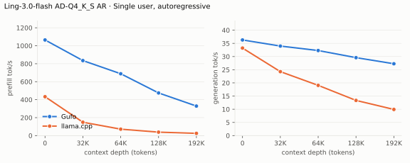
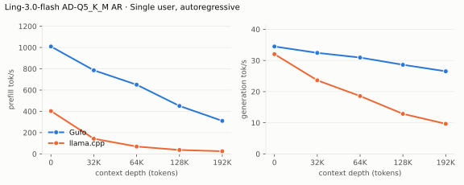
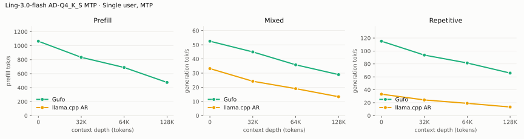
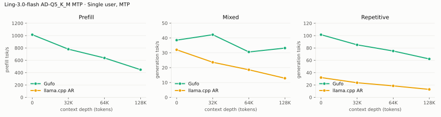
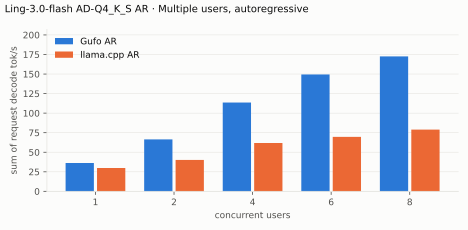
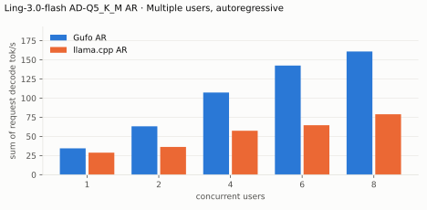
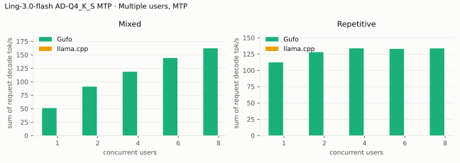
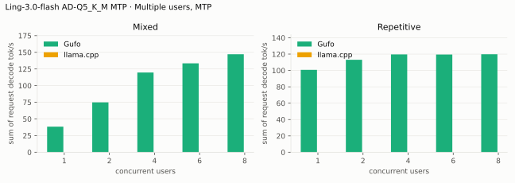
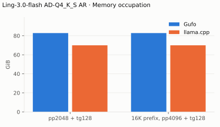
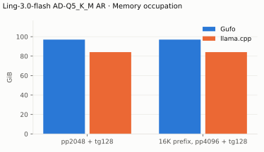

# Ling-3.0-flash benchmarks

AMD Strix Halo `gfx1151`, 128 GB unified memory. Gufo (the v0.17.1 build, gufo
0.17.1.0 at 0cbd54d, plus the evidence kit; see
[Benchmark method](QUALITY.md#benchmark-method)) versus
llama.cpp `server-vulkan-v0.5.0` (`0.5.0-dev`, build 11146, commit 7fe450e19) on
Vulkan with Mesa 26.0.8 RADV, at its production flags `-fa on -ctk q8_0 -ctv
q8_0`. Both engines load the same two published files, **AD-Q4_K_S** (the
production target) and **AD-Q5_K_M**. HTTP, greedy, thinking off, measured
October 19 and 20, 2026 for Gufo and October 12, 2026 for llama.cpp. Positive gain
favors Gufo.
[Quality and measurement details](QUALITY.md) · [Model identities](artifacts/model-identities.json)

**Machines.** Two Strix Halo machines of one configuration measured the files:
**machine A** the AD-Q4_K_S tables and **machine B** the AD-Q5_K_M tables, so
the two quants share no machine. Machine B's board was replaced shortly before
the campaign, and its numbers cannot be compared with earlier measurements
there. Within a table, Gufo and llama.cpp ran back to back on the same machine,
so the gain columns are controlled; a Q4_K_S against Q5_K_M difference carries
the machine as well. Machine B has the 108 GiB GTT limit that the default
12 GiB expanded K/V store needs for Q5_K_M (see
[Memory](README.md#memory-and-sessions)).

## Single user, autoregressive

Approximately pp2048 / tg128; depth is the cached prefix in tokens. One
sample per cell. Gufo runs `--speculative off`.

### AD-Q4_K_S (machine A)

<!-- bench:single-ar-q4ks -->
| Ling-3.0-flash AD-Q4_K_S AR Depth (tokens) | Gufo pp (tok/s) | llama.cpp pp (tok/s) | Gain | Gufo tg (tok/s) | llama.cpp tg (tok/s) | Gain |
| ---: | ---: | ---: | ---: | ---: | ---: | ---: |
| 0 | 1068.50 | 433.01 | +146.8% | 36.32 | 33.21 | +9.4% |
| 32,768 | 838.76 | 148.85 | +463.5% | 33.98 | 24.27 | +40.0% |
| 65,536 | 690.76 | 71.82 | +861.8% | 32.29 | 19.06 | +69.4% |
| 131,072 | 475.21 | 38.61 | +1130.8% | 29.58 | 13.35 | +121.6% |
| 196,608 | 328.55 | 25.04 | +1212.1% | 27.24 | 9.93 | +174.3% |
<!-- /bench -->

The 196,608-token llama.cpp cell of this table was run on machine B (machine A
had returned to production), so that row's gain compares Gufo on machine A with
llama.cpp on machine B.

### AD-Q5_K_M (machine B)

<!-- bench:single-ar-q5km -->
| Ling-3.0-flash AD-Q5_K_M AR Depth (tokens) | Gufo pp (tok/s) | llama.cpp pp (tok/s) | Gain | Gufo tg (tok/s) | llama.cpp tg (tok/s) | Gain |
| ---: | ---: | ---: | ---: | ---: | ---: | ---: |
| 0 | 1015.91 | 402.82 | +152.2% | 35.00 | 32.04 | +9.2% |
| 32,768 | 794.70 | 142.92 | +456.0% | 32.87 | 23.63 | +39.1% |
| 65,536 | 658.43 | 69.28 | +850.4% | 31.27 | 18.58 | +68.3% |
| 131,072 | 458.48 | 36.97 | +1140.1% | 28.74 | 12.86 | +123.5% |
| 196,608 | 318.26 | 24.88 | +1179.2% | 26.54 | 9.66 | +174.7% |
<!-- /bench -->

## Single user, MTP

Gufo drafts from block 42 and also copies repeated passages from the context
(prompt lookup). llama.cpp's own `--spec-type draft-mtp` does not reproduce its
autoregressive output on this model (the d0 qualification run differs), so no
speculative llama.cpp rate is reported. The llama.cpp column here is its
autoregressive rate from the table above, and the gain is Gufo's MTP rate
against it. pp is the larger of the two workloads. Mixed is prose; repetitive
re-quotes earlier text. One sample per cell, so mixed-prose tg moves with each
prompt's draft acceptance (0.01 to 1.06 accepted tokens per step, or 20 to 75% of drafted tokens, in these runs).

### AD-Q4_K_S (machine A)

<!-- bench:single-mtp-q4ks -->
| Ling-3.0-flash AD-Q4_K_S MTP Depth (tokens) | Gufo pp (tok/s) | Gufo tg mixed (tok/s) | llama.cpp AR tg mixed (tok/s) | Gain mixed | Gufo tg repetitive (tok/s) | llama.cpp AR tg repetitive (tok/s) | Gain repetitive |
| ---: | ---: | ---: | ---: | ---: | ---: | ---: | ---: |
| 0 | 1064.41 | 52.53 | 33.21 | +58.2% | 115.13 | 33.21 | +246.7% |
| 32,768 | 834.11 | 44.97 | 24.27 | +85.3% | 93.65 | 24.27 | +285.9% |
| 65,536 | 688.79 | 35.89 | 19.06 | +88.3% | 81.46 | 19.06 | +327.4% |
| 131,072 | 475.24 | 28.96 | 13.35 | +116.9% | 65.84 | 13.35 | +393.2% |
<!-- /bench -->

### AD-Q5_K_M (machine B)

<!-- bench:single-mtp-q5km -->
| Ling-3.0-flash AD-Q5_K_M MTP Depth (tokens) | Gufo pp (tok/s) | Gufo tg mixed (tok/s) | llama.cpp AR tg mixed (tok/s) | Gain mixed | Gufo tg repetitive (tok/s) | llama.cpp AR tg repetitive (tok/s) | Gain repetitive |
| ---: | ---: | ---: | ---: | ---: | ---: | ---: | ---: |
| 0 | 1009.21 | 45.18 | 32.04 | +41.0% | 109.64 | 32.04 | +242.2% |
| 32,768 | 795.27 | 43.22 | 23.63 | +82.9% | 88.18 | 23.63 | +273.2% |
| 65,536 | 660.49 | 35.11 | 18.58 | +89.0% | 76.82 | 18.58 | +313.5% |
| 131,072 | 459.37 | 29.33 | 12.86 | +128.1% | 63.03 | 12.86 | +390.1% |
<!-- /bench -->

## Multiple users, autoregressive

The rate is the **cohort wall-clock aggregate** on both sides: output tokens of
all users divided by the elapsed time of the measured rounds. Gufo batches up
to eight decoding requests in one forward pass when `--speculative off`;
llama.cpp batches its slots. Each user replays a prepared 2,048-token session
with at most 9 tokens re-prefilled.

### AD-Q4_K_S (machine A)

<!-- bench:multi-ar-q4ks -->
| Ling-3.0-flash AD-Q4_K_S AR Users | Gufo AR (tok/s) | llama.cpp AR (tok/s) | Gain |
| ---: | ---: | ---: | ---: |
| 1 | 36.28 | 29.84 | +21.6% |
| 2 | 66.92 | 40.14 | +66.7% |
| 4 | 112.93 | 61.84 | +82.6% |
| 6 | 149.85 | 69.70 | +115.0% |
| 8 | 170.81 | 78.93 | +116.4% |
<!-- /bench -->

### AD-Q5_K_M (machine B)

<!-- bench:multi-ar-q5km -->
| Ling-3.0-flash AD-Q5_K_M AR Users | Gufo AR (tok/s) | llama.cpp AR (tok/s) | Gain |
| ---: | ---: | ---: | ---: |
| 1 | 34.94 | 28.82 | +21.2% |
| 2 | 63.77 | 36.25 | +75.9% |
| 4 | 110.20 | 57.38 | +92.1% |
| 6 | 146.65 | 64.65 | +126.8% |
| 8 | 168.57 | 78.96 | +113.5% |
<!-- /bench -->

## Multiple users, MTP

Same aggregate rule. MTP cohorts share their draft and verify forwards, each
request ending exactly as if it had decoded alone, and the llama.cpp columns are
N/A for the reason in the single-user MTP section. Against the autoregressive
table above, MTP leads on prose up to four users and batched AR leads from six.
Repetitive prompts gain most at few users and flatten at 113-129 tok/s.

### AD-Q4_K_S (machine A)

<!-- bench:multi-mtp-q4ks -->
| Ling-3.0-flash AD-Q4_K_S MTP Users | Gufo mixed (tok/s) | llama.cpp mixed (tok/s) | Gain | Gufo repetitive (tok/s) | llama.cpp repetitive (tok/s) | Gain |
| ---: | ---: | ---: | ---: | ---: | ---: | ---: |
| 1 | 52.47 | N/A | N/A | 114.58 | N/A | N/A |
| 2 | 94.53 | N/A | N/A | 131.66 | N/A | N/A |
| 4 | 137.36 | N/A | N/A | 137.79 | N/A | N/A |
| 6 | 147.13 | N/A | N/A | 136.75 | N/A | N/A |
| 8 | 167.37 | N/A | N/A | 138.90 | N/A | N/A |
<!-- /bench -->

### AD-Q5_K_M (machine B)

<!-- bench:multi-mtp-q5km -->
| Ling-3.0-flash AD-Q5_K_M MTP Users | Gufo mixed (tok/s) | llama.cpp mixed (tok/s) | Gain | Gufo repetitive (tok/s) | llama.cpp repetitive (tok/s) | Gain |
| ---: | ---: | ---: | ---: | ---: | ---: | ---: |
| 1 | 45.11 | N/A | N/A | 109.83 | N/A | N/A |
| 2 | 74.80 | N/A | N/A | 122.37 | N/A | N/A |
| 4 | 126.09 | N/A | N/A | 128.24 | N/A | N/A |
| 6 | 143.80 | N/A | N/A | 126.18 | N/A | N/A |
| 8 | 163.90 | N/A | N/A | 128.72 | N/A | N/A |
<!-- /bench -->

## Memory occupation

Context capacity 133121, autoregressive, one session. Gufo's value is the peak
device-global HIP memory counter during the request, which includes the default
12 GiB expanded K/V store and matches the sysfs GTT peak (82.85 and 97.03 GiB).
The HIP counter does not see llama.cpp's Vulkan allocations, so its value is the
sysfs GTT peak over the whole table run; llama.cpp preallocates its K/V cache,
and one value covers both workloads. Negative gain means Gufo uses more.
Peaks of the other runs are in `artifacts/gtt-peaks-*.json` (Gufo, one
session: AR 83.34 and MTP 85.56 GiB for Q4_K_S; AR 97.52 and MTP 100.09 GiB for
Q5_K_M, each at context 199296).

### AD-Q4_K_S (machine A)

<!-- bench:memory-q4ks -->
| Ling-3.0-flash AD-Q4_K_S AR Workload | Gufo GiB | llama.cpp GiB | Gain |
| --- | ---: | ---: | ---: |
| pp2048 + tg128 | 82.83 | 69.95 | -15.5% |
| 16K prefix, pp4096 + tg128 | 82.83 | 69.95 | -15.5% |
<!-- /bench -->

### AD-Q5_K_M (machine B)

<!-- bench:memory-q5km -->
| Ling-3.0-flash AD-Q5_K_M AR Workload | Gufo GiB | llama.cpp GiB | Gain |
| --- | ---: | ---: | ---: |
| pp2048 + tg128 | 97.01 | 84.12 | -13.3% |
| 16K prefix, pp4096 + tg128 | 97.01 | 84.12 | -13.3% |
<!-- /bench -->

## Not measured for these files

Loading time, the sampled-MTP table and the llama.cpp f16 K/V control were
not repeated for the corrected Q4_K_S and the Q5_K_M files. Earlier f16 K/V
runs on the previous Q4_K_S build gave llama.cpp about 2.6 times the prefill
and 1.23 times the decode of its q8_0 rate at 64k with no quality cost, so
the q8_0 tables above are the more favorable comparison for Gufo.
The earlier results are kept as history in [Experiments](EXPERIMENTS.md#history).
